# Plongée dans les données : la biologie et la physique cachées dans le bioréacteur

*Phase d'analyse uniquement : aucun modèle prédictif n'a été ajusté et rien n'a été soumis. Les seuls ajustements
sont des calculs physiques simples : pentes de ln(cellules), bilans matière, concentrations des feeds.*
Code et chiffres : `notebooks/04_data_deep_dive.ipynb` (version HTML dans `reports/04_data_deep_dive.html`).
Figures : `figures/deep_dive/`. Références : `results/literature_notes.md`.
Données : les 49 lots d'entraînement (toutes les colonnes) et les 12 lots de test (t = 0, feeds, volume).

Unités supposées (non documentées, mais tous les recoupements sont cohérents) : jours, 10⁶ cellules/mL, g/L, litres.

---

## 1. À retenir en une minute

1. **La croissance suit une horloge commune à tous les lots.** μ_max = 0.73 j⁻¹ (doublement en 23 h) de J0 à J3,
   puis la même décélération dans chaque lot. Plateau vers J7.7, puis déclin net à partir de J10. Aucune
   dépendance à la densité, au substrat ni au byproduct. **Le niveau de VCD d'un lot est fixé par son inoculum.**
2. **La baisse de VCD après le pic est surtout de la dilution** (69 %) : la concentration baisse de 29 %, la quantité
   de cellules vivantes de 9 % seulement.
3. **La mort dépend de l'âge** : k_d passe de 0.005 à 0.025-0.027 j⁻¹ et double environ tous les 2-3 jours en fin de culture. Elle ne
   dépend ni du substrat ni du lot. Aucune lyse détectable.
4. **Le substrat obéit à une loi d'overflow** : q_S = 0.11 (maintenance constante) + 0.86 × q_P⁺ (glucose dévié en
   lactate). Pas d'effet Monod jusqu'à S ≈ 0.3-0.8 g/L.
5. **Lactate shift dans 100 % des lots** à J5.5 ± 0.8, exactement quand q_S retombe au niveau de maintenance, alors
   que le substrat est encore à 2.8 g/L (mécanisme de Mulukutla : flux glycolytique faible).
6. **Feeds** : B = feed nutritif concentré (≈ 53 g/L de substrat) suivant un **calendrier préprogrammé** (et non une
   rétroaction sur la VCD). Le feed substrat (≈ 250 g/L) est un **régulateur sur S mesuré**. D = supplément de recette
   fixe. C = additif de régulation à la demande (antimousse ou acide, confiance faible). La **base du régulateur de pH
   est invisible dans les feeds mais visible dans le volume**.
7. **Bruit de mesure** : VCD/TCD ≈ 6.5-7 % (bruit blanc). Cela fixe un plancher de MAPE ≈ 5 % sur VCD/TCD, même pour
   un modèle parfait.
8. **Les lots de test sont dans l'enveloppe d'entraînement** : aucune extrapolation réelle, seulement quelques
   valeurs initiales à la limite.

---

## 2. Qualité des données

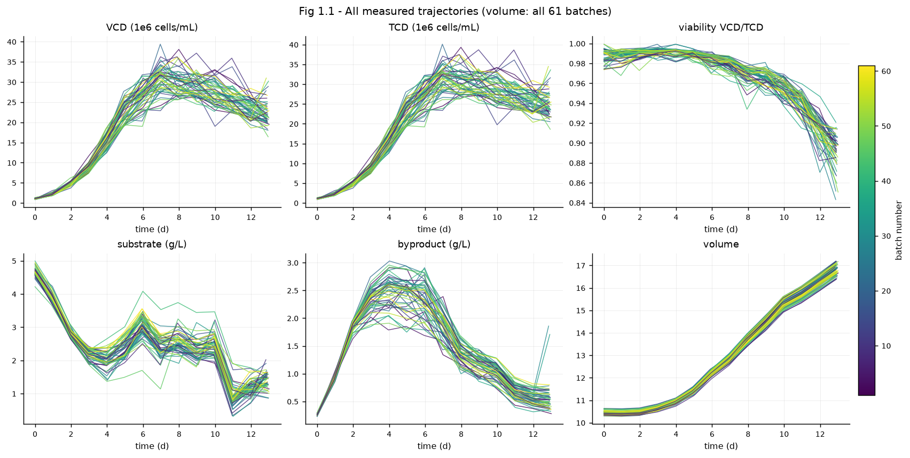

- Le fichier est propre : 61 lots × 14 échantillons quotidiens (gigue ≈ 0.6 h), valeurs manquantes uniquement
  structurelles, TCD ≥ VCD partout, toutes les valeurs > 0, viabilité entre 0.84 et 1.00, aucun doublon.
- 7 points ressemblent à des pics isolés, mais aucun n'est physiquement impossible (par exemple Batch46, S = 1.14 à
  j7, est un vrai creux qui a déclenché un bolus de substrat). On les garde et on utilise des pertes robustes.
- **Bruit de mesure** (estimé par variogramme et par différences secondes, `q1_noise_variogram.png`) :

| Variable | Bruit blanc (CV) | Commentaire |
|---|---|---|
| VCD, TCD | **6.5-7 %** | même comptage (écarts VCD/TCD corrélés à 0.999) ; ≈ la moitié de la dispersion entre lots un jour donné |
| DCD | ≈ 25 % | différence de deux grands nombres |
| Substrat | ≈ 2 % (J1-J3) | plus élevé ensuite à cause des bolus, ce qui est de la dynamique et non du bruit |
| Byproduct | ≈ 3-4 % (J1-J3) | |

---

## 3. Les feeds et leur rôle le plus probable

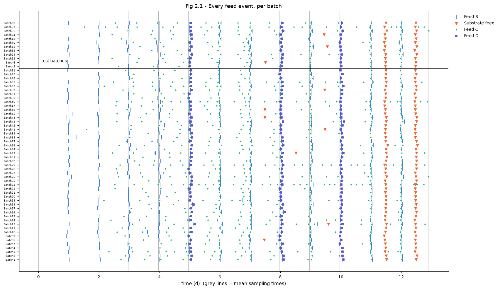

| Feed | Calendrier | Dose | Loi de dosage | Rôle le plus probable | Confiance |
|---|---|---|---|---|---|
| **B** | 12 bolus, ≈ 1 h après chaque prélèvement, J1 → J12 | 0.06 → 0.9 ; total 6.6 (63 % de V₀) | **calendrier préprogrammé** dont la forme suit la VCD attendue. À jour fixé, élasticité à la VCD mesurée = 0.12 seulement. Multiplicateur propre au lot ±4 % | **feed nutritif concentré** (≈ 53 g/L de substrat, sans byproduct ; acides aminés probables) | élevée |
| **Substrat** | 2 bolus tardifs (j11, j12) dans tous les lots + bolus en milieu de culture dans 10/61 lots | **exactement 0.004·V ou 0.006·V** (+1.0 / +1.5 g/L) | **rétroaction sur S mesuré** : 0.006·V si S < 0.96 g/L ; bolus en milieu de culture si S < 1.9 g/L | solution de glucose concentrée (≈ 250 g/L) | élevée |
| **C** | grosses doses 0.0018, 1/jour dès J5 ; petites doses 0.00086 à la demande, à toute heure (3-27 par lot, surtout J3-J7) | volume négligeable (0.2 % de V₀) | programmée + à la demande | additif de régulation : **antimousse** ou **acide** (plus de doses dans les lots moins denses et à lactate final plus bas, ce qui exclut la base) | faible |
| **D** | 3 bolus à J5.04 / 8.05 / 10.03 dans **les 61 lots** | 0.149 / 0.119 / 0.069 % de V (CV < 1 %) | recette fixe, proportionnelle au volume | **supplément** (vitamines, oligo-éléments, cystéine/tyrosine…) ; aucun substrat détectable | moyenne |
| **Base (cachée)** | intervalles 1-5, maximum à l'intervalle 3 | ΔV non expliqué : +0.03 à +0.09 par intervalle | régulateur de pH | **base neutralisant l'acide lactique** ; corrèle avec le pic de lactate (ρ = 0.71). Environ 0.009 V par g de lactate, soit ≈ 1.2 M de base si V est en litres | élevée |

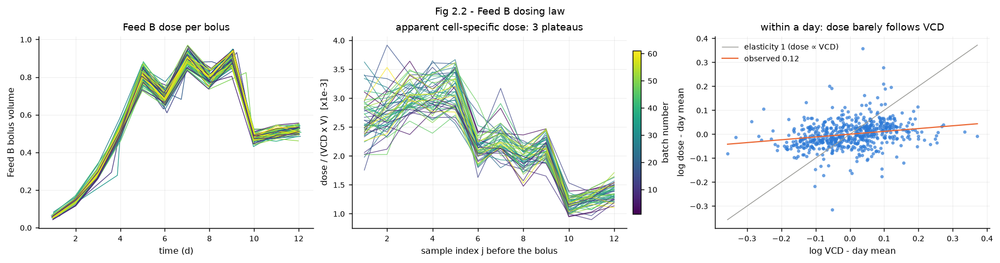

> **Correction d'une hypothèse de l'équipe** : la corrélation « dose de B ∝ dernière VCD (r = 0.87) » de `CLAUDE.md`
> est un artefact temporel (dose et VCD montent puis descendent ensemble). À jour fixé, la dose ne suit presque pas
> la VCD (figure de droite).

---

## 4. Volume et bilans matière

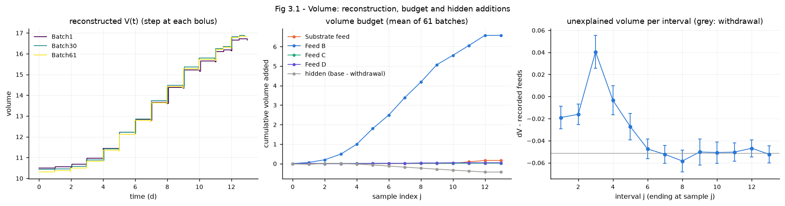

- ΔV = Σ feeds + volume caché (corrélation 0.997). V passe de 10.45 à 16.8 (+61 %), dont 96 % viennent de Feed B.
- En fin de culture, le volume caché vaut −0.051 par intervalle : ≈ 0.02 de prélèvement + 0.031·Δt d'évaporation.
  L'**excédent des intervalles 1-5 correspond à la base** ajoutée pour le pH. Elle est maximale à l'intervalle 3, quand
  le tampon du milieu est épuisé.
- **Concentrations des feeds**, estimées par bilan de substrat avec plusieurs structures de consommation :
  **C_B ≈ 53 g/L** (48-57 selon la structure), **C_F ≈ 250 g/L** (rapport 4.7). Si C_B < 20, la consommation
  calculée serait négative aux jours 4-6, ce qui est impossible (`q3_feed_concentration.png`). Feed B ne contient
  pas de byproduct (0.9, IC −2.2..4.0).

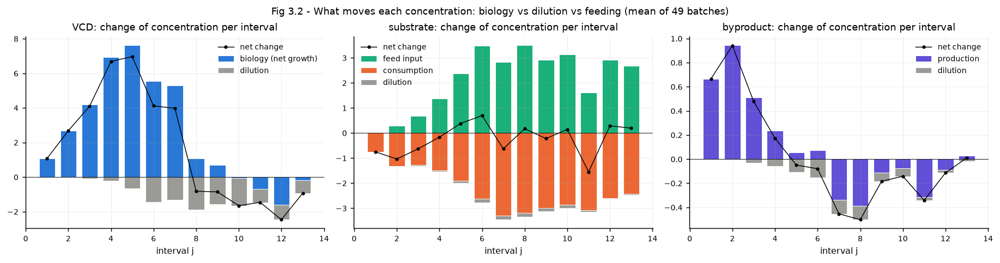

- Après le pic, **69 % du déclin apparent de VCD est de la dilution**. Pour le substrat, l'apport quotidien
  (≈ 3 g/L/j) compense presque exactement la consommation. La baisse du byproduct entre J6 et J9 est surtout de la
  consommation (la dilution en explique environ 20 %).

---

## 5. Lois biologiques trouvées (avec chiffres)

### 5.1 Croissance : une horloge commune
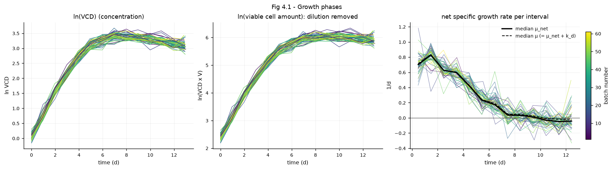

| Phase | Période | μ_net (médiane, j⁻¹) |
|---|---|---|
| Adaptation (latence courte) | J0-J1 | 0.70 (< 0.83 à J1-J2, p = 0.002) |
| Exponentielle | J0-J3 | **μ_max = 0.73 ± 0.03** (doublement 22.9 h, R² 0.993 sur ln N) |
| Décélération | J2-J7 | 0.63 → 0.60 → 0.42 → 0.23 → 0.17 ; t½ = 4.7 ± 0.5 j |
| Stationnaire | J7.7 ± 0.8 → J10 | ≈ 0.01-0.04 |
| Déclin (quantité de cellules) | J10 → J13 | −0.03 à −0.05 |

Pic de VCD : 31.7 ± 3.0 à J7.7. Le pic de la *quantité* de cellules arrive 2 jours plus tard (effet de la dilution).

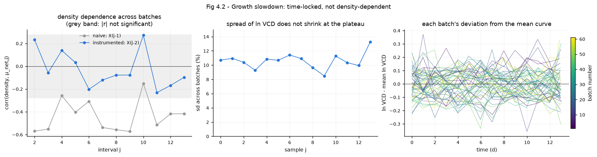

La corrélation naïve « plus de cellules → croissance plus lente » (r ≈ −0.5) est un **artefact du bruit de mesure**
(régression vers la moyenne). Avec un instrument (X mesuré deux échantillons avant), elle disparaît : pente −0.10
(IC −0.23..0.01), contre −0.46 attendu avec une capacité porteuse logistique. De plus, la dispersion de ln VCD entre
lots reste ≈ 10 % jusqu'au plateau, sans convergence. **μ(t) est commun à tous les lots** : la part persistante
propre au lot dans μ_net (J3-J9) est nulle (ICC = 0).

### 5.2 Mort
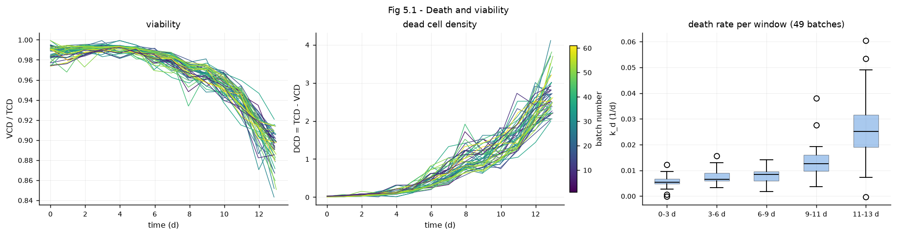

| Fenêtre | 0-3 j | 3-6 j | 6-9 j | 9-11 j | 11-13 j |
|---|---|---|---|---|---|
| k_d médian (j⁻¹) | 0.0053 | 0.0065 | 0.0083 | 0.0126 | **0.0251** |

k_d ne dépend ni du substrat minimal (ρ = 0.03), ni du byproduct, ni de l'IVCD, et n'a pas de composante propre au
lot. C'est une **mort liée à l'âge**. La quantité totale de cellules reste stable après J9 (rapport 0.97, non
significatif) : **pas de lyse détectable**, les cellules mortes s'accumulent.

### 5.3 Substrat, byproduct, rendements
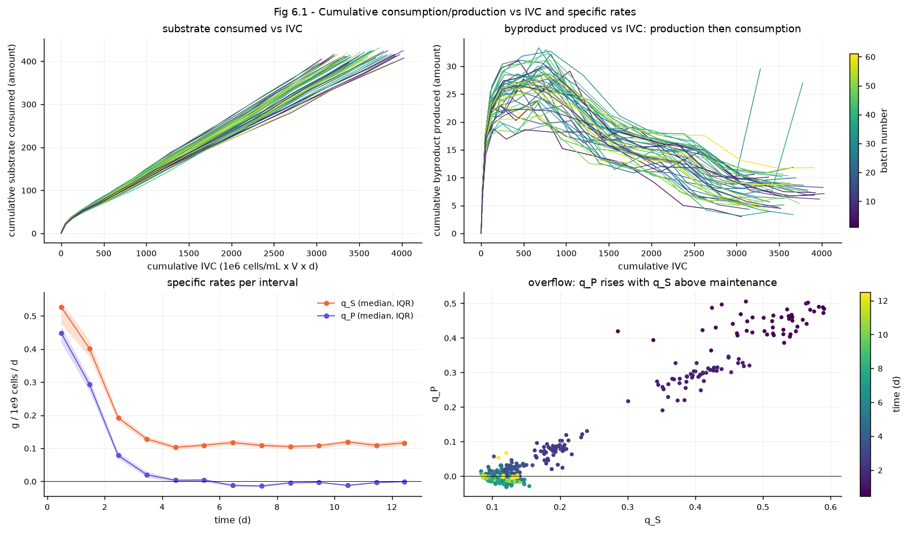

| Paramètre | Valeur | Loi |
|---|---|---|
| q_S J0-J4 | 0.53 → 0.40 → 0.19 → 0.13 g/10⁹ cellules/j | overflow |
| **q_S à partir de J4** | **0.11 ± 0.01** constant (≈ 0.6 pmol/cellule/j si glucose) | maintenance d'ordre zéro (pente de Pirt ≈ 0) |
| **Loi d'overflow** | q_S = 0.11 + 0.86 · q_P⁺ | 0.86 g de substrat par g de byproduct (théorie : 1 g/g) |
| q_P | 0.45 → 0.29 → 0.08 → 0 à J5, puis **−0.012 à −0.014** (J6-J8), ≈ 0 ensuite | production puis consommation |
| Y_P/S (exponentielle) | 0.63 g/g = 1.26 mol/mol (max 2) | effet Warburg marqué |
| Y_X/S (exponentielle) | ≈ 2.4·10⁹ cellules/g | |
| Luedeking-Piret | R² = 0.48 (0.01 après le shift) | **inadapté** |
| Monod en S | q_S identique de S ≈ 0.3 à 5 g/L | **aucune limitation détectable** |

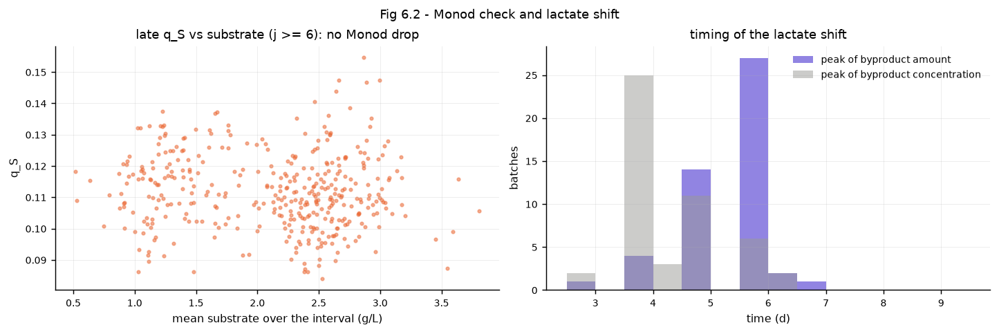

**Lactate shift** dans les 49 lots : pic de la quantité de byproduct à J5.5 ± 0.8 (pic de concentration à J4.5).
Il se produit quand q_S atteint le niveau de maintenance (0.110 ± 0.013) alors que S vaut encore 2.8 g/L. 8 % des lots
reproduisent un peu de byproduct en toute fin de culture.

---

## 6. Qu'est-ce qui arrête la croissance ?

Valeurs à t½ (fin de croissance exponentielle) : S = 2.32 ± 0.32 g/L, P = 2.43 ± 0.30 g/L (≈ 27 mM), viabilité 0.99.
Aucune variable n'est *moins* dispersée à t½ qu'à un temps fixe : il n'y a donc pas de seuil critique.

| Hypothèse | Pour | Contre | Confiance |
|---|---|---|---|
| H1 limitation en substrat (Monod) | — | S ≥ 1.4 g/L à t½ (≫ K_S) ; q_S plat en S ; μ non corrélé à S entre lots | **rejetée** |
| H2 inhibition par le byproduct | décélération quand P est maximal (J3-J5) | P ≈ 27 mM, la moitié des 55 mM qui divisent μ par 2 (Ozturk 1992) ; μ continue de baisser quand P diminue (J5-J9) ; aucune corrélation entre lots | **rejetée comme cause principale** |
| H3 déplétion d'un nutriment de B/C/D | les plateaux de dose par cellule de B baissent à J6 et J10 | les lots denses reçoivent moins de B par cellule sans croître moins vite ; pas de seuil sur le B cumulé | **non soutenue pour B** ; D et C programmées sont fixées dans le temps, donc **non testables** |
| H4 densité / capacité porteuse (logistique, O₂/CO₂) | — | pente instrumentée ≈ 0 ; dispersion constante ; t½ indépendant de l'inoculum (r = −0.02) | **rejetée** |
| **H5 pilotage temporel commun** (shift programmé de T/pH, osmolalité/CO₂ liés aux feeds identiques, arrêt en G1) | μ(t) identique dans tous les lots ; ICC = 0 ; aucun seuil d'état | le mécanisme exact n'est pas observable | **soutenue (élevée)** |
| H6 stress acide (pH bas pendant l'ajout de base) | l'ajout de base (J2-J5) coïncide avec le début de la décélération | aucun lien entre lots (r = 0.03) | faible |

**Conclusion** : la croissance s'arrête selon une **horloge commune** (âge de la culture), et non à cause d'un état
mesuré. Le modèle doit traiter μ comme une fonction du temps et non comme Monod(S)·Inhib(P).

---

## 7. Ce qui explique les différences entre lots

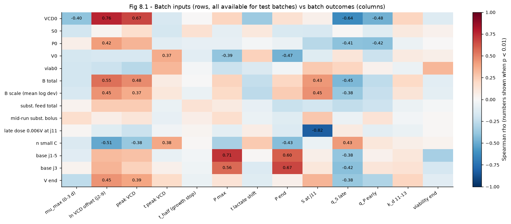
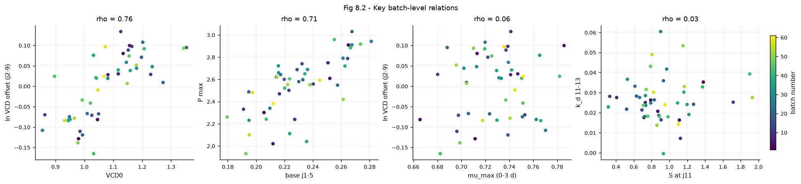

- **Niveau de VCD ← inoculum** : R²(décalage de ln VCD ~ ln VCD₀) = 0.54 (0.77 avec μ_max) ; ρ(VCD₀, pic) = 0.67.
- **Niveau de byproduct ← base cachée** (le régulateur de pH lit le lactate) : ρ(base J1-J5, P max) = 0.71,
  ρ(base, P final) = 0.60.
- **Substrat tardif ← régulateur de substrat** (dose 0.006·V ↔ S11 bas, ρ = −0.82) et échelle de Feed B (0.45).
- **Rien parmi les entrées disponibles n'explique** μ_max, t½, la date du shift, k_d ou la viabilité finale : ce sont
  des comportements communs au procédé, plus du bruit.
- Les quantités consommées/produites varient moins que proportionnellement au nombre de cellules mesuré
  (élasticité 0.3-0.5 au début, ≈ 0.15 en fin de culture).

---

## 8. Test vs entraînement

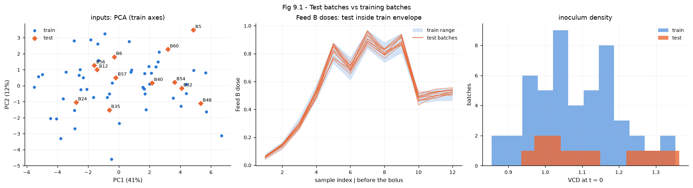

- **Pas d'extrapolation réelle**. 14 alertes univariées sur 312, toutes marginales :
  - Batch54 : S₀ = 4.16 (minimum d'entraînement 4.22) et bolus de substrat en milieu de culture ;
  - Batch32 : VCD₀ = 1.363 (maximum 1.353) ;
  - Batch5/40/57 : P₀ entre 0.302 et 0.308 (maximum 0.300) ;
  - quelques doses de B jusqu'à 3 % hors de la plage.
- Toutes les distances de Mahalanobis restent dans la distribution de validation croisée (Batch40 au 90ᵉ percentile).
- **Risque structurel** : 3 lots de test (Batch6, 35, 54) ont un bolus de substrat en milieu de culture, un régime
  représenté par seulement 7/49 lots d'entraînement.

---

## 9. Recommandations pour le futur modèle

### Variables dérivées à calculer (toutes disponibles pour les lots de test)
1. **Âge de la culture t** : principal moteur de μ et de k_d.
2. **ln VCD₀** (inoculum), avec rétrécissement : il fixe le niveau de VCD mais porte 7 % de bruit.
3. **V(t) reconstruit et facteurs de dilution** : passer en **quantités** (C·V).
4. **Apport de substrat** = 53·B + 250·F (masse, cumulée) ; apport ≈ consommation en fin de culture.
5. **Volume de base caché** par intervalle (J1-J5) : lecture directe de la production de lactate.
6. **États des régulateurs de substrat** : taille de la dose tardive (0.004/0.006·V ⇒ S11/S12 au-dessus ou en dessous
   de 0.96) ; bolus en milieu de culture ⇒ S < 1.9 à l'échantillon précédent.
7. **Échelle de Feed B** (écart log moyen des doses) : indicateur faible du niveau de VCD (ρ = 0.45).

### Contraintes physiques à imposer
- TCD ≥ VCD ; quantité de cellules mortes non décroissante (pas de lyse détectée) ; dilution exacte à chaque bolus.
- Saut de S à chaque bolus de substrat : +0.004·250 = **+1.0 g/L** ou +1.5 g/L.
- q_S ≥ 0 et ≈ 0.11 constant après J4 ; byproduct produit seulement pendant l'overflow, consommé après le shift.
- Base ↔ lactate (stœchiométrie ≈ 0.009 V par g).

### Structure d'équations de départ (en quantités N = X·V, M_S = S·V, M_P = P·V)
```
dN/dt   = (μ(t) − k_d(t)) · N            μ(t) : courbe commune (0.73 jusqu'à J3, → 0 vers J7.7)
dN_d/dt = k_d(t) · N                      k_d(t) ≈ 0.005 + 2e-4·exp(0.38·t)  (0.005 → 0.025)
dM_S/dt = 53·F_B(t) + 250·F_F(t) − q_S·N  q_S = m + b·q_P⁺,  m ≈ 0.11,  b ≈ 0.86
dM_P/dt = q_P(t)·N                        q_P > 0 avant le shift (≈ (q_S − m)/b), < 0 après ;
                                          shift quand q_S → m (≈ J5.5)
V(t) donné ; concentrations = quantités / V
```
Un **décalage par lot** (inoculum) suffit pour la VCD. Pour le byproduct, le décalage se lit dans la base cachée.

### Variables inutiles ou trompeuses
- **Feed D et les grosses doses de Feed C** : recette fixe, aucune information.
- **Termes de Monod en S et d'inhibition par P** dans μ ou k_d : aucun effet visible dans nos données.
- **Capacité porteuse logistique** : rejetée.
- **Dose de B / VCD** comme loi de rétroaction : artefact temporel.
- **Utiliser une VCD mesurée ponctuelle comme régresseur** : 7 % de bruit, donc régression vers la moyenne.
- **S₀, P₀, viabilité₀, V₀** : effets faibles ou nuls (P₀ et V₀ seulement faiblement liés aux niveaux de P).
- Ne pas chercher à descendre sous ≈ 5 % de MAPE sur VCD/TCD : c'est le plancher fixé par le bruit de mesure
  (meilleur leaderboard actuel : 7.16).
